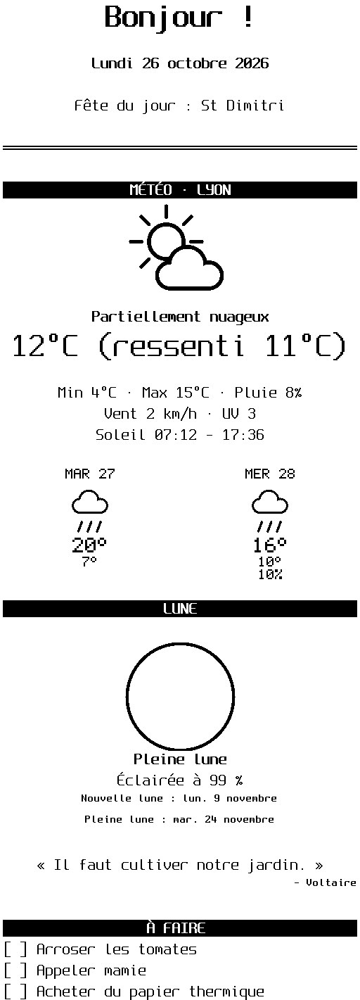
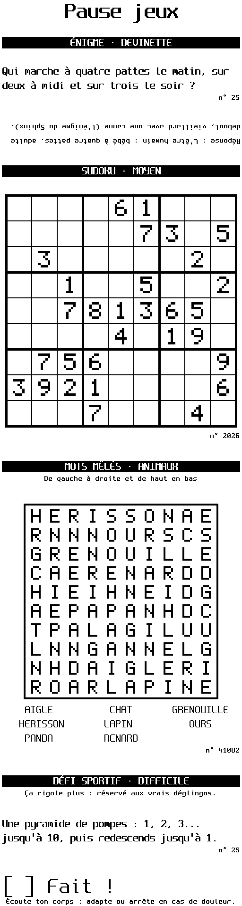

<p align="center">
  <picture>
    <source media="(prefers-color-scheme: dark)" srcset="docs/logo-dark.png">
    
  </picture>
</p>

<p align="center"><strong>Des petits tickets qui font du bien, tous les matins.</strong></p>

<p align="center">
  <a href="https://xninety9.github.io/Printr/"></a>
  
  
  
</p>

<p align="center">
  <a href="https://xninety9.github.io/Printr/guide.html">Documentation</a> ·
  <a href="https://xninety9.github.io/Printr/blocs.html">Les blocs</a> ·
  <a href="https://github.com/XNinety9/Printr/releases">Télécharger</a> ·
  <a href="README.md">🇬🇧 English</a>
</p>

Printr transforme une imprimante à tickets **Epson TM-T88V** en gadget familial. On compose un
ticket à partir de **56 blocs** (météo, horoscope, sudoku, mots mêlés, énigmes, actualités,
photos…), on l'imprime depuis son téléphone, on le **planifie** pour 7 h 30 en semaine, ou on
envoie un **petit mot avec une photo** à ceux qui sont restés à la maison. Un seul binaire Rust,
sur un Raspberry Pi, qui parle ESC/POS directement à l'imprimante.

<p align="center">
  
  &nbsp;
  
  &nbsp;
  
</p>

- **56 blocs** : météo et comment s'habiller, ciel du soir, horoscope en quatre tons, recettes,
  histoire du soir, anniversaires, tâches ménagères, mots croisés, sudoku, kakuro, échecs, coloriage,
  liste de courses, actualités, photos…
- **Une appli web pour la famille** : comptes, tickets enregistrés et partagés, aperçu en direct,
  planification, historique.
- **Ne perd aucun ticket** : imprimante éteinte, capot ouvert ou plus de papier ? Le ticket attend, et
  l'appli dit pourquoi.
- **S'intègre à la maison** : Home Assistant (découverte automatique), MQTT, Node-RED, API HTTP.
- **Sobre** : presque tout est calculé localement ou vient d'API gratuites. Claude n'écrit que ce qui
  demande une plume, par de petits appels à Claude Haiku, toujours mis en cache.

## Démarrage rapide

```sh
cargo run --release -- --preview print examples/complet.json   # aperçu dans le terminal, sans imprimante
scripts/deploy.sh pi@printer.local                             # installer sur un Raspberry Pi (ou --local)
```

Ouvrez ensuite `http://printer.local:8080` : l'appli vous fait créer votre compte, puis ceux de la famille.

## Imprimantes supportées

Conçu et testé sur l'**Epson TM-T88V** (USB). Les autres imprimantes ESC/POS 80 mm devraient
fonctionner, en USB ou en réseau ; les imprimantes 58 mm ne sont pas prises en charge. Le détail dans
la section [imprimantes supportées](https://xninety9.github.io/Printr/guide.html#imprimantes-supportées).

## Documentation

Tout le reste est dans le **[guide](https://xninety9.github.io/Printr/guide.html)** (source : [docs/guide.fr.md](docs/guide.fr.md)) :

- [Les blocs et les tickets JSON](https://xninety9.github.io/Printr/guide.html#tickets-json), avec
  [un exemple de chaque bloc](https://xninety9.github.io/Printr/blocs.html)
- [L'appli web](https://xninety9.github.io/Printr/guide.html#interface-web) et l'[API HTTP](https://xninety9.github.io/Printr/guide.html#serveur-http)
- [MQTT](https://xninety9.github.io/Printr/guide.html#mqtt) et [Node-RED](https://xninety9.github.io/Printr/guide.html#node-red)
- [L'installation](https://xninety9.github.io/Printr/guide.html#installation) et la [sécurité](https://xninety9.github.io/Printr/guide.html#sécurité)
- [Tester sans imprimante](https://xninety9.github.io/Printr/guide.html#tester-sans-imprimante-émulateur)
- [Contribuer](CONTRIBUTING.fr.md) · [Journal des versions](CHANGELOG.md) (en anglais)

## Les étoiles sur GitHub

<a href="https://www.star-history.com/?repos=xninety9%2Fprintr&type=date&legend=top-left">
  <picture>
    <source media="(prefers-color-scheme: dark)" srcset="https://api.star-history.com/chart?repos=xninety9/printr&type=date&theme=dark&legend=top-left">
    <source media="(prefers-color-scheme: light)" srcset="https://api.star-history.com/chart?repos=xninety9/printr&type=date&legend=top-left">
    
  </picture>
</a>

## Licence

Printr est distribué sous [licence Apache 2.0](LICENSE) : vous pouvez le réutiliser, le modifier et le
redistribuer, à condition de conserver le fichier [NOTICE](NOTICE), qui cite l'auteur original et la
bibliothèque CrossWords incluse.
