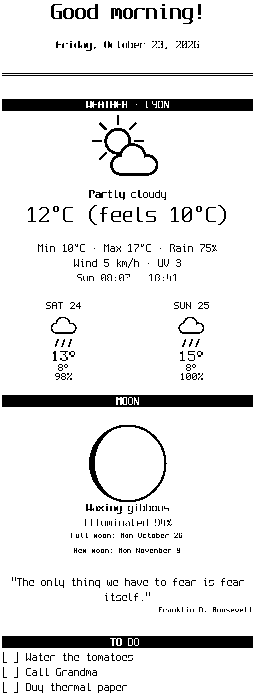

<p align="center">
  <picture>
    <source media="(prefers-color-scheme: dark)" srcset="docs/logo-dark.png">
    
  </picture>
</p>

<p align="center"><strong>Little receipts that do you good, every morning.</strong></p>

<p align="center">
  <a href="https://xninety9.github.io/Printr/"></a>
  
  
  
</p>

<p align="center">
  <a href="https://xninety9.github.io/Printr/guide.en.html">Documentation</a> ·
  <a href="https://xninety9.github.io/Printr/blocs.html">Blocks</a> ·
  <a href="https://github.com/XNinety9/Printr/releases">Download</a> ·
  <a href="README.fr.md">🇫🇷 Français</a>
</p>

Printr turns an **Epson TM-T88V** receipt printer into a family gadget. You compose a ticket from
**56 blocks** (weather, horoscope, sudoku, word search, riddles, news, photos…), print it from your
phone, **schedule** it for 7:30 on weekdays, or send a **little note with a photo** to the people
who stayed home. A single Rust binary, running on a Raspberry Pi, that speaks ESC/POS directly to
the printer.

<p align="center">
  
  &nbsp;
  
  &nbsp;
  
</p>

- **56 blocks**: weather with what to wear, tonight's sky, horoscope in four tones, recipes, bedtime
  stories, birthdays, chores, crosswords, sudoku, kakuro, chess, coloring, shopping list, news, photos…
- **A web app for the family**: accounts, saved and shared tickets, live preview, scheduling, history.
- **Ready to flash**: an image for the Raspberry Pi; plug in the printer, power on, and set up the
  Wi-Fi from your phone with the ticket it prints. A wizard and in-app settings do the rest.
- **Never loses a ticket**: printer off, cover open or out of paper? The ticket waits, and the app says why.
- **Plays well with the house**: Home Assistant (integration or automatic discovery), MQTT, Node-RED, HTTP API.
- **Lean**: almost everything is computed locally or comes from free APIs. Claude only writes what
  needs a pen, with small Claude Haiku calls, always cached.

## Quick start

**On a Raspberry Pi**: write the [ready-to-flash image](https://github.com/XNinety9/Printr/releases)
to a microSD card with Raspberry Pi Imager, plug in the printer and power on
([details](https://xninety9.github.io/Printr/guide.en.html#ready-to-flash-image)).

**From the source code**:

```sh
export PRINTR_LANG=en                                          # English app and tickets (French by default)
cargo run --release -- --preview print examples/complet.json   # preview in the terminal, no printer needed
scripts/deploy.sh pi@printer.local                             # install on a Raspberry Pi (or --local)
```

Then open `http://printer.local:8080`: the app asks you to create your account, then the family's.

## Supported printers

Built and tested on the **Epson TM-T88V** (USB). Other 80 mm ESC/POS printers should work, over USB
or the network; 58 mm printers are not supported. Details in the
[supported printers](https://xninety9.github.io/Printr/guide.en.html#supported-printers) section.

## Documentation

Everything else is in the **[guide](https://xninety9.github.io/Printr/guide.en.html)**
(source: [docs/guide.md](docs/guide.md)):

- [Blocks and JSON tickets](https://xninety9.github.io/Printr/guide.en.html#json-tickets), with an
  [example of every block](https://xninety9.github.io/Printr/blocs.html)
- [The web app](https://xninety9.github.io/Printr/guide.en.html#web-interface) and the
  [HTTP API](https://xninety9.github.io/Printr/guide.en.html#http-server)
- [Home Assistant](https://xninety9.github.io/Printr/guide.en.html#home-assistant), [MQTT](https://xninety9.github.io/Printr/guide.en.html#mqtt) and
  [Node-RED](https://xninety9.github.io/Printr/guide.en.html#node-red)
- [Installation](https://xninety9.github.io/Printr/guide.en.html#installation) and
  [security](https://xninety9.github.io/Printr/guide.en.html#security)
- [Testing without a printer](https://xninety9.github.io/Printr/guide.en.html#testing-without-a-printer-emulator)
- [Contributing](CONTRIBUTING.md) · [Changelog](CHANGELOG.md)

## Star history

<a href="https://www.star-history.com/?repos=xninety9%2Fprintr&type=date&legend=top-left">
  <picture>
    <source media="(prefers-color-scheme: dark)" srcset="https://api.star-history.com/chart?repos=xninety9/printr&type=date&theme=dark&legend=top-left">
    <source media="(prefers-color-scheme: light)" srcset="https://api.star-history.com/chart?repos=xninety9/printr&type=date&legend=top-left">
    
  </picture>
</a>

## License

Printr is licensed under the [Apache License 2.0](LICENSE): you can reuse, modify and redistribute it,
as long as you keep the [NOTICE](NOTICE) file, which credits the original author and the bundled
CrossWords library.
